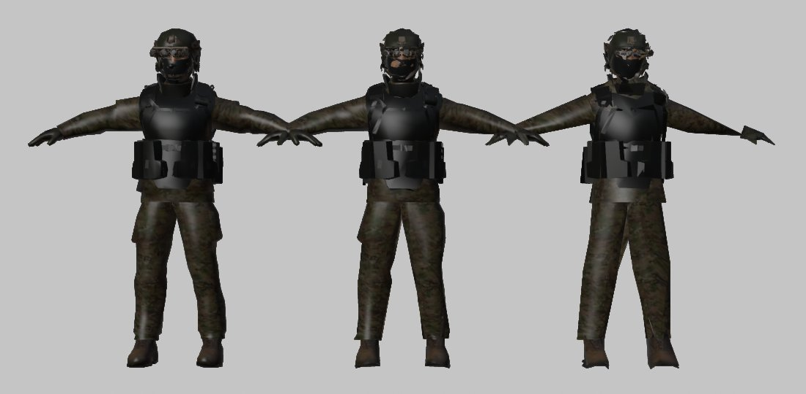
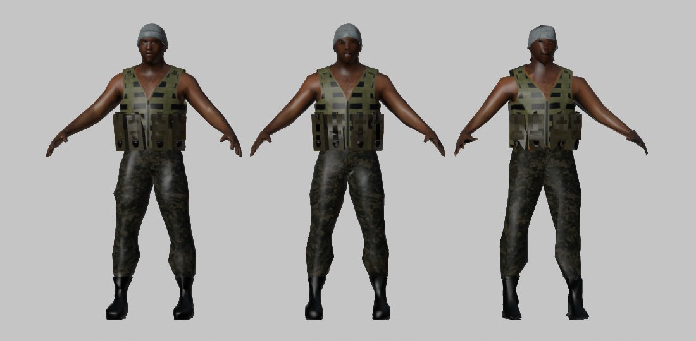

The default player classes for [Fatal Contact](https://github.com/zees-games/game-fatal-contact): one class per team, each with a rigged body model, and its LODs. This repo holds only the manifest (`classes.json`), credits and tools. The models are on the GameSpice CDN and you fetch them with `./fetch-content.sh`.

Store page: [FC Player Classes (asset 152)](https://moddingcommunity.com/a/152-fc-player-classes)

| SWAT (team 1) | Military (team 2) |
|---|---|
|  |  |

## Classes

| Class | Team | Body file | LOD tris (0 / 1 / 2) |
|---|---|---|---|
| SWAT | 1 (side a) | `fc_swat.glb` | 9999 / 3000 / 1200 |
| Military | 2 (side b) | `fc_military.glb` | 9998 / 2997 / 784 |

Both bodies use the gs-player-char kit skeleton (43 bones, 1.8 m), so every kit animation plays on them. Each one ships as a `.glb` with PNG/JPEG textures and as a `.webp.glb` for web builds. The schema is in [docs/manifest.md](docs/manifest.md).

## Quick start

| Step | Command |
|---|---|
| Fetch the models into `assets/models/` | `./fetch-content.sh` (Windows: `fetch-content.ps1`) |
| Check the manifest | `python3 tools/models.py check` |
| Check the fetched files against the manifest | `python3 tools/models.py check --files` |

Fatal Contact loads a team body by file name (`<body_id>.glb`) from its team-body folders, so the fetched files drop in without being renamed.

## Updating a model

| Step | Command |
|---|---|
| Prepare the body with gs-player-char's avatar prep | see [docs/models.md](docs/models.md) |
| Copy the prepared kit GLBs into `assets/models/` | `python3 tools/models.py stage <prep out dir>` |
| Pin bytes and sha256 into `classes.json` | `python3 tools/models.py pin` |
| Publish and update `content.lock.json` | `tools/publish.sh <version> --token-file <creator token>` |

Commit `classes.json` and `content.lock.json` together. Model files are never committed.

## Quality and ongoing improvement

These models keep improving: LOD tuning, far impostors, compressed textures and first-person arm fixes are tracked on Nightly under the fc-player-classes project. Re-fetch after a new lock lands.

## Credits

| Model | Author | Licence |
|---|---|---|
| SWAT operator | SpatialNeglect, from parts by bobeer, VassKacsoHunor, Simon Coenen, Bzovius, Albin, Shedmon and h1ggs | CC BY 4.0 |
| Military character | jayb3e | CC BY 4.0 |

Full credits with links are in [CREDITS.md](CREDITS.md). The code and manifest are MIT ([LICENSE](LICENSE)). Per-file licences are in `licence.json` and `assets/models/licence.json`.
